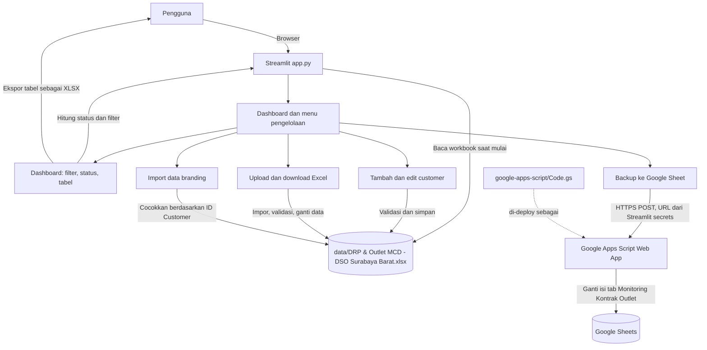

# Arsitektur Sistem Monitoring Kontrak Outlet

## Gambaran umum

Monitoring Kontrak Outlet adalah aplikasi web berbasis Streamlit untuk melihat dan mengelola data customer, memantau masa berlaku kontrak, memperbarui data dari laporan branding, serta mengekspor dan membackup data. Logika aplikasi berada di `app.py`; data utama disimpan sebagai workbook Excel lokal.

## Diagram komponen

## Komponen

| Komponen | Tanggung jawab |
| --- | --- |
| `app.py` | Antarmuka Streamlit, validasi, normalisasi, status kontrak, filter dashboard, impor/ekspor, pembaruan data, dan permintaan backup. |
| `data/DRP & Outlet MCD - DSO Surabaya Barat.xlsx` | Sumber data awal dan penyimpanan lokal untuk daftar outlet. Sheet aplikasi bernama `Monitoring Kontrak Outlet`. |
| `google-apps-script/Code.gs` | Endpoint Apps Script yang menerima payload backup, memvalidasi struktur kolom, dan menulis data ke Google Sheets. |
| `GOOGLE_APPS_SCRIPT_URL` | URL Web App yang disimpan di Streamlit secrets; aplikasi tidak meng-hardcode URL deployment. |
| Google Sheets | Salinan backup pada tab `Monitoring Kontrak Outlet`; backup mengganti isi tab tersebut. |

## Alur data

### Memuat dan mengelola customer

1. Saat aplikasi dimulai, `load_initial_data()` membaca workbook lokal. Pembacaan mencoba sheet `COSPKR06` dengan header pada baris yang sesuai, kemudian format workbook yang didukung lainnya.
2. `normalize_data()` menyelaraskan variasi nama kolom ke skema aplikasi, mengubah nominal dan tanggal ke tipe yang sesuai, serta menormalkan kolom materi dan ukuran panel.
3. Dashboard menghitung sisa hari kontrak dari tanggal akhir terhadap tanggal hari ini, lalu menetapkan status: expired, kritis (maksimal 30 hari), warning (31–90 hari), aktif (lebih dari 90 hari), atau data belum lengkap.
4. Pengguna dapat memfilter berdasarkan Zona, Sektor, Pos Budget, Kategori Pekerjaan, dan Status Kontrak.
5. Baris dengan Pos Budget Venue dan Others Permanen ditampilkan pada tabel tersendiri. Tiga tabel hasil filter memiliki ekspor XLSX masing-masing.
6. Form tambah/edit memvalidasi data sebelum menyimpan workbook lokal. Impor workbook dari dashboard memvalidasi data dan mengganti seluruh daftar customer.

### Import laporan branding

1. Menu **Import data branding** membaca laporan SPKS Branding dari sheet `COSPKR06`.
2. Baris dengan ID Customer yang sama dideduplikasi; baris dengan `Tanggal Pekerjaan Sampai` terbaru dipilih.
3. Data terpilih dicocokkan dengan `ID Outlet` pada daftar customer. ID yang cocok memperbarui kolom customer, kategori, alamat, zona, brand, nominal, serta tanggal kontrak yang tersedia.
4. ID yang tidak ditemukan ditampilkan terpisah dan tidak ditambahkan ke daftar customer. Baris tanpa ID juga ditampilkan terpisah. Nilai kosong dari laporan tidak mengosongkan nilai yang sudah tersimpan.

### Backup ke Google Sheets

1. Menu **Backup ke Google Sheet** membaca `GOOGLE_APPS_SCRIPT_URL` dari Streamlit secrets.
2. Aplikasi mengirim seluruh data yang telah dinormalisasi sebagai JSON melalui HTTPS POST.
3. Apps Script menulis header dan baris ke tab `Monitoring Kontrak Outlet`; tab lain tidak diubah. Jika tab tujuan belum ada, script membuatnya.
4. Endpoint tidak menggunakan token. Siapa pun yang mengetahui URL Web App dapat mengirim permintaan dan mengganti isi tab tujuan. Karena itu URL harus disimpan sebagai rahasia dan tidak dimasukkan ke kode atau dokumentasi.

## Skema data aplikasi

Data utama menggunakan kolom:

- Identitas dan lokasi: `ID Outlet`, `Nama Customer`, `Alamat`, `Zona`, `Sektor`.
- Anggaran dan kategori: `Pos Budget`, `Kategori Outlet`, `Kategori Pekerjaan`, `Brand`.
- Nilai dan masa kontrak: `Nominal Kontrak`, `Periode Kontrak Awal`, `Periode Kontrak Akhir`.
- Materi: `Panel Toko`, `Showcase`, `Layar Toko`, `Shop Sign / Neon Box`.
- Ukuran: `Ukuran Panel Toko`, `Ukuran Sticker Panel Toko`.

Kolom `Sisa Hari` dan `Status Kontrak` dihitung saat ditampilkan dan bukan bagian dari data master yang disimpan.

## Teknologi dan konfigurasi

- Python, Streamlit, dan Pandas untuk aplikasi web serta transformasi data.
- `openpyxl` untuk membaca dan menulis file Excel.
- `requests` untuk komunikasi HTTPS dengan Apps Script.
- Google Apps Script dan Google Sheets untuk backup jarak jauh.
- Konfigurasi lokal menggunakan `.streamlit/secrets.toml`; pada Streamlit Community Cloud, URL diatur melalui **Settings > Secrets**.
